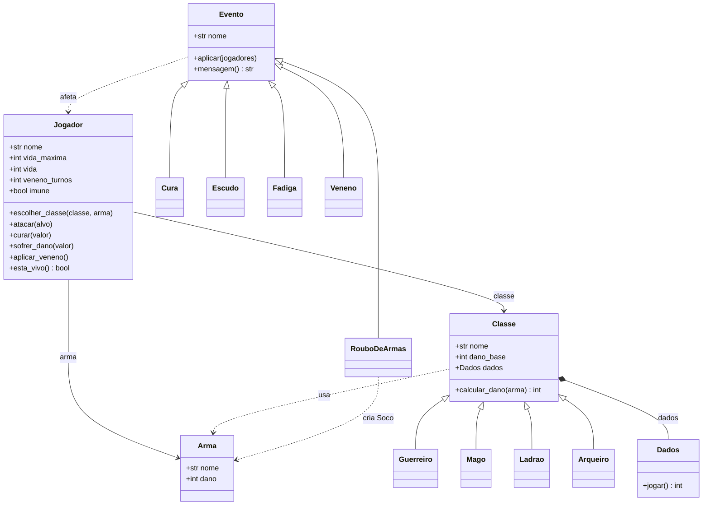

# ⚔️ Arena PvP (RPG Arena)

Jogo de duelo por turnos para dois jogadores, feito em **Python**. Cada jogador escolhe um nome e uma classe, e os dois se enfrentam até que a vida de um chegue a zero. Eventos aleatórios podem mudar o rumo da batalha a qualquer momento.

O jogo tem duas versões que usam a mesma lógica: uma para o **terminal** e outra com **interface gráfica** (tkinter).

## 👥 Integrantes

- Alison Flor
- Murilo Dias
- Gabriel Ribeiro
- João Alschefsky

## 🎮 Como o jogo funciona

- Dois jogadores escolhem um nome e uma entre quatro classes. Cada classe vem com uma arma inicial.
- Cada jogador começa com **200 de vida**.
- Os jogadores se alternam: a cada turno, um ataca o outro.
- O dano de um ataque é: **dano base da classe + dano da arma + um dado de 20 lados (1 a 20)**.
- Vence quem deixar a vida do adversário em 0.

### Classes

| Classe | Dano base | Arma inicial | Dano da arma |
|---|---|---|---|
| Guerreiro | 15 | Espada | 10 |
| Mago | 20 | Cajado | 12 |
| Ladrão | 12 | Daga | 8 |
| Arqueiro | 14 | Arco | 9 |

### Eventos aleatórios

No começo de cada turno há **30% de chance** de acontecer um evento:

| Evento | Efeito |
|---|---|
| Cura | Os dois jogadores recuperam 20 de vida |
| Escudo | Um jogador sorteado fica imune ao próximo ataque que receber |
| Fadiga | Um jogador sorteado perde 10 de vida |
| Veneno | Um jogador sorteado perde 8 de vida por turno, durante 3 turnos |
| Roubo de Armas | Os dois jogadores perdem a arma e lutam no soco (arma "Soco", dano 0) |

O escudo bloqueia apenas ataques; veneno e fadiga atravessam a imunidade.

## 🚀 Como executar

### Requisitos

- **Python 3.10 ou superior** (o projeto usa `match`, que não existe em versões anteriores).
- **tkinter**, que já vem instalado com o Python no Windows. No Linux, pode ser preciso instalar o pacote `python3-tk`.
- **Pillow** (opcional), usado para redimensionar os sprites da interface gráfica:

```bash
pip install pillow
```

### Baixar o projeto

```bash
git clone <url-do-repositorio>
cd <pasta-do-repositorio>
```

### Versão com interface gráfica

```bash
python main_gui.py
```

1. Na primeira tela, escolha o nome e a classe de cada jogador.
2. Clique em **INICIAR BATALHA**.
3. A cada turno, clique em **ATACAR** (ou aperte **ENTER**) para o jogador da vez atacar.
4. Acompanhe os ataques e eventos no diário de batalha. Clique em **NOVO JOGO** para recomeçar.

Os sprites ficam na pasta `sprites/`, com os nomes `guerreiro.png`, `mago.png`, `ladrao.png` e `arqueiro.png`. Se uma imagem não existir, a interface mostra um ícone no lugar.

### Versão para terminal

```bash
python main.py
```

Digite o nome e a classe (1 a 4) de cada jogador e aperte **ENTER** a cada turno para atacar.

## 📁 Estrutura do projeto

```
.
├── main.py          # Versão para terminal
├── main_gui.py      # Versão com interface gráfica (tkinter)
├── jogador.py       # Classe Jogador: vida, ataque, cura, veneno e imunidade
├── classes.py       # Classe base e profissões (Guerreiro, Mago, Ladrao, Arqueiro)
├── arma.py          # Classe Arma (nome e dano)
├── dados.py         # Dado de 20 lados usado no dano
├── evento.py        # Eventos aleatórios
└── sprites/         # Imagens das classes (interface gráfica)
```

## 🧩 Diagrama de classes



- **Herança:** as quatro profissões herdam de `Classe`; os cinco eventos herdam de `Evento`.
- **Associação:** `Jogador` guarda uma `Classe` e uma `Arma`, recebidas de fora.
- **Composição:** `Classe` cria e guarda o seu próprio `Dados`.
- **Dependência:** `Classe` usa a `Arma` só para calcular o dano; `Evento` afeta o `Jogador`; `RouboDeArmas` cria a arma "Soco".

## 🕓 Histórico de versões

1. **Código em módulos:** divisão do código em `arma.py`, `dados.py`, `classes.py`, `jogador.py` e `main.py`.
2. **Validação da classe:** o jogo repete a pergunta até a escolha ser de 1 a 4.
3. **Eventos aleatórios:** cura, escudo, fadiga, veneno e roubo de armas.
4. **Escudo como imunidade:** o escudo passa a bloquear o próximo ataque.
5. **Interface gráfica:** telas de configuração e de batalha em tkinter, com diário colorido e sprites.

## ⚠️ Observações

- Se os dois jogadores chegarem a 0 de vida no mesmo turno, o jogo declara o jogador 2 vencedor. O empate ainda não é tratado.
- Os eventos não imprimem mais a própria mensagem: quem mostra o texto é quem os chama. No `main.py` do terminal, é preciso ter `print(evento.mensagem())` logo depois de `evento.aplicar(jogadores)` para as mensagens aparecerem.
- No `main.py` do terminal, o dicionário `CLASSES` cria classe e arma uma única vez, então dois jogadores com a mesma classe dividem os mesmos objetos. A interface gráfica cria objetos novos para cada jogador.
